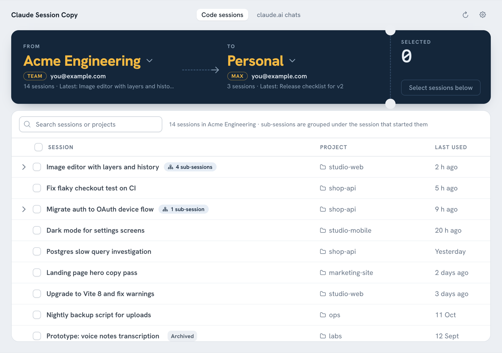

# Claude Session Copy

A small desktop app (with a CLI) that copies your **Claude** sessions and chats to a **different Claude organization or a different Claude account**.

- **Claude Code sessions** from the Claude desktop app (the *Code* tab) are copied directly, including the full conversation history, so you can keep working on them in the other account or org.
- **claude.ai chats** can't be imported into another account (Claude has no import feature). The app turns your official data export into tidy Markdown files that you upload to a Project in the new account.



> Unofficial tool, not affiliated with Anthropic. It works with the Claude desktop app's local files, whose layout may change between app versions. Your original sessions are never modified.

## Download

Grab the latest build from the [**Releases**](https://github.com/shivanshtalwar0/claude-session-copy/releases/latest) page:

| Platform | File |
| --- | --- |
| Windows 10/11 | `ClaudeSessionCopy-windows-x64.exe` |
| macOS (Apple Silicon, M1 or later) | `ClaudeSessionCopy-macos-apple-silicon.zip` |
| macOS (Intel) | `ClaudeSessionCopy-macos-intel.zip` |
| Linux x64 | `ClaudeSessionCopy-linux-x64.tar.gz` |

The builds aren't code-signed, so your OS will warn the first time:

- **macOS:** unzip, then right-click **Claude Session Copy.app → Open → Open**. If it says the app is damaged, run `xattr -dr com.apple.quarantine "Claude Session Copy.app"` once.
- **Windows:** if SmartScreen appears, click **More info → Run anyway**.
- **Linux:** `tar -xzf ClaudeSessionCopy-linux-x64.tar.gz && ./claude-session-copy` (needs WebKitGTK, which most desktops already have: `sudo apt install gir1.2-webkit2-4.1` on Ubuntu/Debian)

## Copy Claude Code sessions to another account or org

1. **Sign in to the target account/org once** in the Claude desktop app, so the app creates its local folder. Then switch back to wherever you like.
2. Open **Claude Session Copy**. The ticket at the top shows the route, using the same names the Claude app uses, for example **Developers-77o** `TEAM` → **Personal** `MAX`, with the account email under each. If the names can't be read, a short code from the org's ID is shown instead, such as `A117`.
3. Click the **From** code to choose where the sessions are now, and the **To** code to choose where they should go.
4. Tick the sessions you want. Search filters by title or project folder.
5. Click **Copy N sessions**.
6. **Restart the Claude desktop app** and switch to the target organization. The copies appear in the sidebar, titled with " (copied)" by default. You can change that suffix in Settings.

### Sub-sessions come along with their parent

Sessions that another session started (sub-sessions) and forked sessions are shown **under the session they came from**, with a count like "13 sub-sessions". Ticking a parent ticks and locks everything below it, and the copies keep the same parent/child structure in the target org. A sub-session copied on its own becomes a normal top-level session there.

### What gets copied

| Copied | Not copied (the app rebuilds these for the new org) |
| --- | --- |
| Full conversation transcript, including subagent and tool files | Connector / MCP settings from the old org |
| Title, project folder, model, effort, permission mode | Cloud environments, remote-control links |
| Linked PRs, branches, archived state | Links to other sessions (except parent/sub-session links within the copy) |

Each copy gets fresh IDs and its own copy of the transcript, so continuing it in one place never affects the other.

## Move claude.ai chats to another account

1. In the **old** account: claude.ai → **Settings → Privacy → Export data**. You'll get an email with a `.zip`.
2. In Claude Session Copy, open the **claude.ai chats** tab, choose the `.zip` and click **Convert**. A folder of Markdown files is created next to the `.zip`.
3. In the **new** account: create a Project and upload the chats you need from the `chats/` folder. For each folder under `projects/`, create a project, upload its files, and paste `_project.md` into the project instructions.

Claude can then read and continue from that history. The chats won't appear as native chat history, because Claude doesn't allow importing that.

## Command line

The CLI needs only Python 3.9+. The desktop window also needs `pip install -r requirements.txt` and the built frontend (see below).

```bash
git clone https://github.com/shivanshtalwar0/claude-session-copy && cd claude-session-copy
python3 -m claude_session_copy                      # opens the desktop app
python3 -m claude_session_copy list                 # accounts / orgs and their sessions
python3 -m claude_session_copy sessions --from a575/a117   # shows sub-sessions as a tree
python3 -m claude_session_copy copy --from a575/a117 --to c30a/b91a --all --dry-run
python3 -m claude_session_copy copy --from a575/a117 --to c30a/b91a --session 02d2dd1a 5ad1af4c
python3 -m claude_session_copy chats-to-md ~/Downloads/claude-export.zip --out claude-chats-md
```

`ACCOUNT/ORG` take unique prefixes of the folder UUIDs shown by `list`. Sub-sessions of the chosen sessions are always included unless you pass `--no-children`. Other `copy` options are `--include-archived`, `--title-suffix " (copied)"` and `--share-transcript`. Use `--app-dir` / `--config-dir` if your data lives somewhere non-standard.

## How it works

The Claude desktop app keeps Code sessions in

```
<app data>/claude-code-sessions/<account-uuid>/<org-uuid>/local_<id>.json   session metadata
<app data>/claude-code-sessions/<account-uuid>/<org-uuid>/archived-sessions.idx
~/.claude/projects/<project-folder-slug>/<transcript-id>.jsonl              conversation transcript
```

where `<app data>` is `~/Library/Application Support/Claude` on macOS, `%APPDATA%\Claude` on Windows, and `~/.config/Claude` on Linux.

Copying a session clones its metadata into the target `<account>/<org>` folder under a new ID, drops fields tied to the old org, and clones the transcript under a new transcript ID. A sub-session records its parent in `spawnedFrom.sessionId`, or `forkedFromSessionId` for forks. Those links are rewritten to point at the parent's new ID.

Organization names, plans and account emails are read from the desktop app's local cache of your claude.ai account (`<app data>/IndexedDB/https_claude.ai_*`). That cache is Snappy-compressed V8 data, and the app decodes it in pure Python. Nothing is sent over the network, and no tokens or cookies are read.

Sessions started from the `claude` command in a terminal aren't tied to an account at all. `claude --resume` already works after you switch accounts.

## Build from source

The app is a [Vue 3](https://vuejs.org) + [PrimeVue 4](https://primevue.dev) frontend (`frontend/`) shown in a native window by [pywebview](https://pywebview.flowrl.com), which uses the system's web view (WebKit on macOS, Edge WebView2 on Windows, WebKitGTK on Linux). The Python package does all the file work and the frontend calls it through pywebview's JS bridge.

```bash
npm ci --prefix frontend && npm run build --prefix frontend   # builds into claude_session_copy/web
python3 -m venv .venv && .venv/bin/pip install -r requirements.txt
.venv/bin/python -m claude_session_copy                       # run the desktop app

# work on the UI in a browser with sample data (no Python needed)
npm run dev --prefix frontend

# single-file executable
.venv/bin/pip install pyinstaller
.venv/bin/pyinstaller --onefile --windowed --name ClaudeSessionCopy \
  --add-data "claude_session_copy/web:claude_session_copy/web" run.py
```

GitHub Actions builds every platform on each push and publishes a release when a `v*` tag is pushed.

PrimeVue is pinned to 4.x on purpose. PrimeVue 5 moved to a license-key model, while 4.x stays MIT, which suits an open-source app.

## License

MIT
